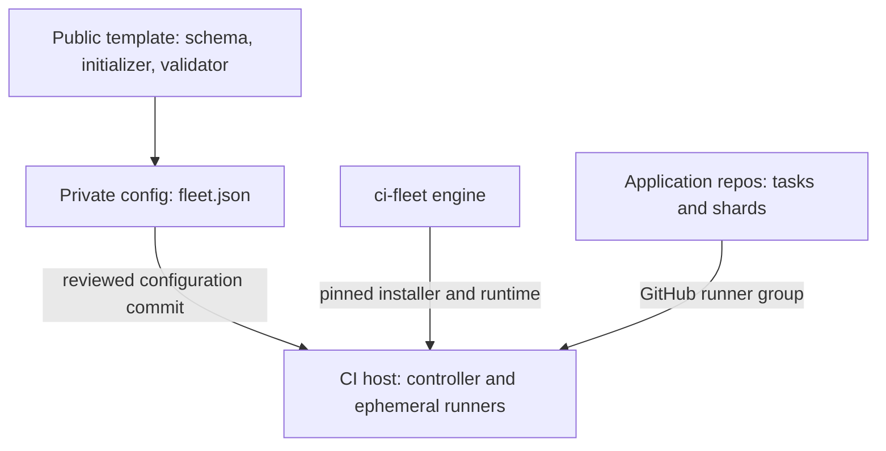

# ci-fleet configuration template

Use this public template to create a private configuration repository for
ordinary CI. Put project access, runner pools, controller capacity and reviewed
engine and image pins in `fleet.json`. Application repositories define their
CI jobs. The ci-fleet engine installs and runs the controllers on separate hosts.



## Install your first CI controller

Use an immutable, reviewed revision of this template and the reviewed ordinary-CI
engine commit `840fb9be8a1c69404a5eebcf17855eff13c6c928`. This path uses the
development template. The latest published tag, `v1.1.0`, predates its
managed-image contract and current systemd validation suite.

Before starting, prepare:

- A GitHub organization, a private configuration repository and an authorized
  private application repository. Set up the GitHub App and a runner group for
  your pool. Follow the [pinned GitHub App setup guide](https://github.com/RandomDevelopment/ci-fleet/blob/840fb9be8a1c69404a5eebcf17855eff13c6c928/docs/GITHUB-APP-SETUP.md).
- Reviewed controller and runner image config digests for your target
  architecture, `amd64` or `arm64`. Obtain them on a separately authorized
  isolated build host using the [managed-image guide](docs/MANAGED-IMAGES.md#image-identity).
- A separate disposable Linux worker for the [complete local validation suite](docs/LOCAL-VALIDATION.md#prerequisites-and-trusted-inputs)
  and an authorized, isolated CI controller host. The controller needs Debian 12
  or newer, Docker Engine with Compose v2 and direct local socket access,
  Docker disk usage below 80%, protected host identity and read-only access to
  the private configuration repository. See the [pinned host prerequisites](https://github.com/RandomDevelopment/ci-fleet/blob/840fb9be8a1c69404a5eebcf17855eff13c6c928/docs/DESIRED-STATE.md#prepare-host-local-identity).

1. Copy the reviewed template into your private repository and initialize one
   project and controller. Replace the organization, project, controller,
   location and image placeholders. Choose capacity that fits the target.

   ```bash
   ./scripts/init.sh \
     --organization your-org \
     --project your-app \
     --controller ci-01 \
     --location primary-site \
     --capacity-budget 1 \
     --max-runners 1 \
     --engine-ref 840fb9be8a1c69404a5eebcf17855eff13c6c928 \
     --architecture amd64 \
     --controller-image-digest sha256:REVIEWED_CONTROLLER_SCALAR \
     --runner-image-digest sha256:REVIEWED_RUNNER_SCALAR
   ```

   Set `--architecture` to the target host architecture and use the reviewed
   image config digests for that architecture and engine.
   The two values must be distinct and nonzero. The public example images are
   placeholders. Run `./scripts/init.sh --help` for additional options. The
   initializer checks its output before replacing it and requires explicit
   `--force` to replace a configured file.

2. Review the logical mappings in `fleet.json`. Keep the
   `engine-rollout-evidence.json` controller map empty for the first install
   and leave optional reporting, Docker network policy and storage retention
   absent. Run the focused policy check before committing:

   ```bash
   ./scripts/validate.sh --strict
   ```

3. Commit the configuration and run the [complete suite](docs/LOCAL-VALIDATION.md#run-the-complete-suite)
   against that exact commit. Use an independently reviewed suite checkout,
   compatible installed executor and independently pinned engine validator.
   The strict policy check covers only part of the suite. Local validation
   needs no hosted Actions run. Hosted validation defaults off. Preserve any
   existing required checks and trusted host acceptance policy.
4. Review and integrate the validated configuration. If integration creates a
   new commit, validate it before using it. On the authorized CI host, check out
   the [pinned engine](https://github.com/RandomDevelopment/ci-fleet/tree/840fb9be8a1c69404a5eebcf17855eff13c6c928)
   and follow its [first controller install](https://github.com/RandomDevelopment/ci-fleet/blob/840fb9be8a1c69404a5eebcf17855eff13c6c928/docs/DESIRED-STATE.md#install-a-fresh-controller).
   Run the engine installer with `--install`, your repository and controller
   ID, and the full reviewed configuration commit as `--ref`. Repeat with
   `--check` against the same commit and require `CHECK_OK`.
5. Run an ordinary CI job from the authorized project through its runner
   group. The first install is verified when the complete suite passes on
   the installed configuration commit, the host reports `CHECK_OK`, and
   the job completes on an ephemeral runner in the intended group.

Application repositories publish `scripts/ci/plan.json` and implement
`./scripts/ci/run.sh <task> --shard INDEX/TOTAL` in their Docker test
environment. Keep `fast` and `full` as aggregate developer commands.
Submit all independent jobs and leave worker capacity to the fleet. Each
ordinary job has a five-minute ceiling. Target at most four minutes of test
payload per shard to leave time for startup and reporting. Assign each
runner group to one pool, keep public repositories out of the pool, and
include both active and drained controller maxima in its capacity budget.

## Deployment inventory

`host_groups`, `environments`, project `deployments` and
`required_secret_names` describe logical inventory. The template and its
initializer neither install nor enable a deployer. Inventory flags and passed
validation confer no deployment approval. Production entries require
`requires_approval: true` and `automatic: false`.

The reviewed standalone deployer supports separately authorized staging on a
dedicated host and rootless daemon. It uses protected host-local policy,
an application-owned adapter, a digest-pinned image and independent approval of
the exact source and artifact. The reviewed core supports verified-stop rollback
for exclusive staging services through host-local policy. Production deployment,
cleanup and rollback remain disabled.
See the [deployment policy guide](docs/DEPLOYMENT-POLICY.md) and the
[pinned core deployer runbook](https://github.com/RandomDevelopment/ci-fleet/blob/461a707a688dd4cd03ddbc15a0bad69ff34b6635/docs/DEPLOYER-HOST.md).
The [end-to-end deployer diagram](https://github.com/RandomDevelopment/ci-fleet/issues/182)
and [first staging deploy guide](https://github.com/RandomDevelopment/ci-fleet/issues/183)
are tracked in the core repository and pending publication.

## Where to go next

Maintainers and agents use the same guides. Agents start with [AGENTS.md](AGENTS.md)
for repository rules and use the guide for the task below.

| Task | Guide |
| --- | --- |
| Install the first controller | [Fresh install](#install-your-first-ci-controller) |
| Validate a committed configuration | [Complete local validation](docs/LOCAL-VALIDATION.md) |
| Add deployment inventory or prepare a separate staging deployer | [Deployment policy](docs/DEPLOYMENT-POLICY.md) |
| Update an existing private repository or controller | [Upgrade guide by installed baseline](docs/UPDATING.md#start-from-your-baseline) |
| Configure optional host-enforced approval | [Adoption and recovery](docs/UPDATING.md#optional-host-enforced-configuration-approval) and the [pinned engine contract](https://github.com/RandomDevelopment/ci-fleet/blob/4467042bad40fcf1530840b8b4454d88ed526a21/docs/CONFIGURATION-APPROVAL.md) |
| Verify a template tag or review compatibility history | [Release records](docs/RELEASE.md) |

Use `fleet.schema.json` for editor validation and `template-compatibility.json`
to review the pinned contracts. The optional adopter-owned
`next-engine-rollout-evidence.json` belongs to [engine upgrades](docs/UPDATING.md#upgrade-an-image-enforced-controller).

The [initial release tag](https://github.com/RandomDevelopment/ci-fleet-config-template/releases/tag/v1.0.0)
was published on September 2, 2026. Its compatibility record retains the
historical preparation state committed before publication. Keep the released commit unchanged.

## What belongs in Git

The public template contains schema, tools and fictional examples. Private
configuration Git contains real repository names, logical IDs and locations,
capacity, reviewed pins and required secret names. Keep credentials, private
keys, host addresses, VM and storage details, and rendered runtime files
outside Git. Use [protected credential storage](SECURITY.md) and establish
deployment approval separately.

The only address exception is reviewed Docker allocation policy in
`default_address_pools[].base` and `default_bridge_cidr`, after engine support
has been staged. The [Docker policy guide](docs/UPDATING.md#optional-docker-network-and-storage-policy)
covers optional policy and why documentation CIDRs must stay in review fixtures.

The public engine and template use the [Unlicense](LICENSE). See
[third-party notices](THIRD_PARTY_NOTICES.md) when copying third-party material.
