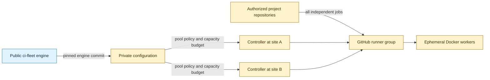
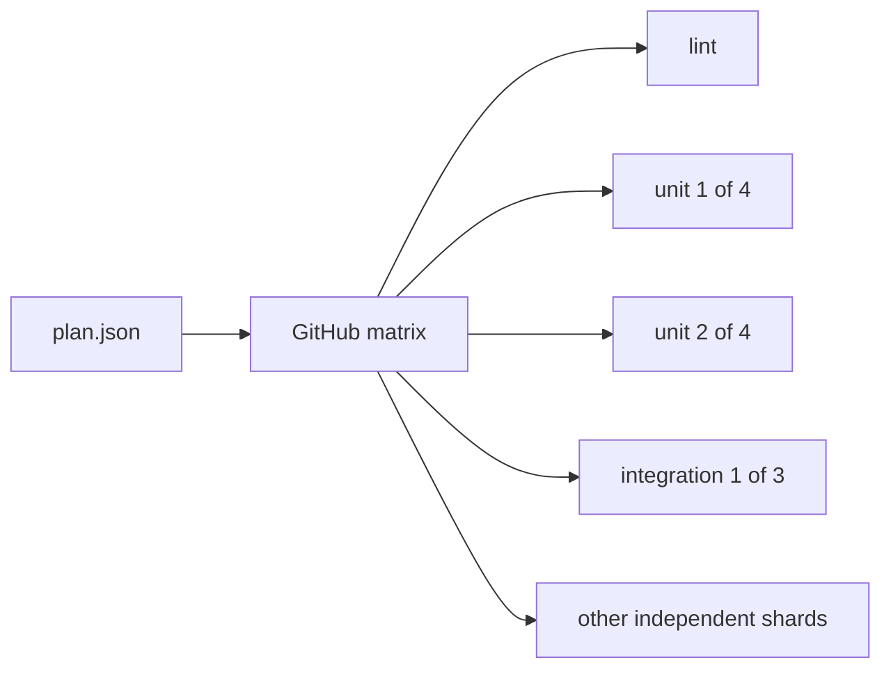

# ci-fleet configuration template

This is the public, secret-free starting point for an organization's private `ci-fleet` configuration repository. It records which trusted projects may use each CI pool, the reviewed desired state for controller machines, infrastructure capacity budgets, logical deployment environments, and the standardized commands every project must expose.

It does **not** contain runner registration tokens, deploy credentials, private keys, host addresses, VM IDs, storage names, backup identifiers, or `.env` files. The narrow address exception covers reviewed Docker `default_address_pools[].base` and `default_bridge_cidr` values after an adopter has staged engine support. These define Docker network allocation and its default bridge, without admitting host or service addresses. Public examples and fixtures use RFC 5737 ranges only.



## Start a private organization configuration

1. Create a **private** repository from this public template.
2. Clone it and initialize the first project and controller:

   ```bash
   ./scripts/init.sh \
     --organization your-org \
     --project your-app \
     --controller ci-01 \
     --location primary-site \
     --capacity-budget 1 \
     --max-runners 1 \
     --engine-ref REVIEWED_ENGINE_COMMIT_SHA
   ```

3. Edit `fleet.json` to add the organization's real logical mappings.
4. Run the focused strict policy check, review and commit the initialized
   configuration, then run the [complete local suite](docs/LOCAL-VALIDATION.md)
   against that exact commit:

   ```bash
   ./scripts/validate.sh --strict
   ```

   This focused check alone does not run the complete suite. The complete
   command needs a separate reviewed template checkout, an independently
   pinned engine validator and explicit source/base identities. It needs no
   GitHub Actions execution, hosted allowance or paid account.

5. Keep secret values outside Git. GitHub Free private repositories cannot use Environments or Environment secrets. Team supports private Environment secrets, but required reviewers for private repositories require Enterprise. Root-owned host files and external secret managers are alternatives for secret storage. A secret store does not supply deployment approval.

The initializer refuses to replace a configured file unless `--force` is explicit. Run `./scripts/init.sh --help` for repository, registry, runner-group, controller, location, capacity, resource, and output options.

Optional `--default-bridge-cidr 192.0.2.1/24` also prints a review-only Docker network-policy fragment for up to 30 runners. It leaves optional fields out of the generated `fleet.json`. Replace documentation CIDRs with reviewed operational policy and complete [capability staging](docs/UPDATING.md#optional-docker-network-and-storage-policy) before inserting a fragment into private configuration. Larger network policies need a separate reviewed design; this fragment limit does not restrict ordinary initialization without the flag.

## Complete local validation

Run this command on a supervised disposable Linux machine with `/proc` mounted,
kernel support for child subreapers and pidfds, Bash, Git, Python 3.11 or newer
and the documented validation tools. Replace every SHA placeholder with a full
reviewed commit identity:

```bash
python3 -I /trusted/template/scripts/local_validate.py \
  --repository /work/config --repository-name OWNER/REPOSITORY \
  --source SOURCE_SHA --base BASE_SHA --main MAIN_SHA \
  --policy-repository /trusted/ci-fleet --policy REVIEWED_ENGINE_VALIDATOR_SHA \
  --output /results/new-dir
```

Choose a new output directory outside every Git worktree and Git storage path.
Ignored artifact directories inside source, template or engine repositories
are rejected, including through subdirectories or symlink aliases.

The suite validates committed content in fresh temporary checkouts for each
stage. It checks source, engine-policy and trusted-suite manifests and uses
independent engine policy. Checkouts fetch only explicit commit SHAs and their
ancestry, without unrelated branches or tags. Git identity checks use stored
objects with replacement refs and grafts disabled; orchestration and stage
environments filter caller-supplied `GIT_*` settings. A separate command
supervisor owns descendants through cleanup. It preserves the standalone policy, updater,
exact-core, release-update and initializer checks. It writes per-check logs,
tool versions, identities and digests to the new output directory. Public
fictional fixtures remain distinct from strict initialized-adopter validation.
See [the runbook](docs/LOCAL-VALIDATION.md) for prerequisites, network needs,
expected skips, merged commits and the difference between a developer result
and trusted signed host evidence. Stage isolation prevents persistent changes
from replacing later stages' inputs; independent review, supervised execution
and a separate signing authority remain required.

`.github/workflows/validate.yml` is an optional hosted convenience and defaults
off. To opt in, set repository Actions variables `CI_FLEET_HOSTED_VALIDATION`
to the literal `true` and `CI_FLEET_VALIDATOR_REVISION` to an independently
reviewed full engine commit SHA. The workflow calls the same entry point with
read-only permissions. Set the flag to `false`, delete it, or remove that
workflow to stop hosted validation. Local validation still works. The flag
changes neither application Actions scheduling nor self-hosted fleet workflows,
and does not control the separately authorized template updater.
Its job and check context are named `hosted-validation`. It never reports
`validate`, so enabling or skipping it cannot satisfy an existing required
`validate` check or the updater's unchanged gate.

Enabling convenience does not make its check required. Existing required-check
and host policies need a deliberate migration before disabling their hosted
path. An unavailable, quota-blocked, skipped or failed hosted run is not a
passing result. Follow [migration and rollback](docs/UPDATING.md#local-validation-and-hosted-cutover).

Trusted local host acceptance depends on the pending engine contract in
[ci-fleet PR #137](https://github.com/RandomDevelopment/ci-fleet/pull/137).
The reviewed proposed reference `96f277b3a75f3d2bef3c04ceb7b3c8778b8998c2` is
unmerged, not the template's merged compatibility baseline or a released
engine. This implementation publishes no release and activates no host policy.

## Reviewed compatibility and release state

`template-compatibility.json` pins the reviewed embedded template to ci-fleet commit `aa9bbb27a4746fc80ce27d8932de68450b28364b`. It records schema and validator/initializer support, optional capabilities, standalone safety checks, and the unchanged fictional example engine pin. `engine-rollout-evidence.json` records active per-controller capability evidence in the shape consumed by that pinned core. New status-reporting, Docker network-policy, and default-bridge fields require prior-state evidence.

Remove storage-retention admission in an earlier integrated change and verify
convergence before changing `engine_ref`. The reviewed evidence format has no
storage-capability field. Upgrade with retention absent, then separately verify
the new engine and daemon inventory before a later re-admission change.
Adding or retaining admission also requires current and previous controller
states to be `active` or `drained`. Remove admission when disabling a
controller, and enable it without admission before a later admission change.
For any reporting or Docker network capabilities that remain active, use
exactly two integrated commits:

1. Keep `fleet.json` and `engine-rollout-evidence.json` on engine A. Add reviewed engine B capability evidence to optional adopter-owned `next-engine-rollout-evidence.json`, using the same schema-version-1 record shape.
2. Change `engine_ref` to engine B, promote the matching sidecar record to `engine-rollout-evidence.json`, and remove the sidecar when it has no remaining staged records.

The default examples and initializer omit optional fields because their engine capability has not been staged. The [network-policy review fragment](examples/docker-network-policy.json) shows syntax only. Before private activation, replace its RFC 5737 CIDRs with reviewed operational pools and bridge values. Storage retention stays absent by default and has a separate engine-first admission rule. Follow [Docker policy adoption and rollback](docs/UPDATING.md#optional-docker-network-and-storage-policy).

Capacity telemetry is another engine capability. A private adopter may
adopt a compatible engine that advertises `capacity_telemetry`, then review the
host-local report before making a separate private capacity change. Updating this public template
does not change the public fixture's engine pin, add telemetry fields, or
activate sampling on any host.

The initial [`v1.0.0` release](https://github.com/RandomDevelopment/ci-fleet-config-template/releases/tag/v1.0.0) was published on September 2, 2026. See [release evidence and exclusions](docs/RELEASE.md) for the exact tag object, template commit, and reviewed core commit. `template-compatibility.json` records the historical preparation state committed before publication. Keep that record and the released commit unchanged, and never retarget or recreate `v1.0.0`. Follow the [adopter update guide](docs/UPDATING.md) to verify the tag object before importing it.

The proposed `v1.0.1` patch release is prepared, not published. See [its release notes, compatibility review, and validation evidence](docs/RELEASE.md#prepared-v101-release).

Adopters can opt into [weekly template update PRs](docs/UPDATING.md#weekly-template-update-prs). The updater preserves fleet configuration, delivery policy, and rollout evidence. Conflicts and schema migrations produce a draft PR for manual handling. Engine-pin upgrades stay separate, and every update requires validation and human review.

## Deployment policy boundary v2

Boundary v2 supports separately authorized adoption of the standalone staging
deployer at reviewed ci-fleet commit `c67d18d24ceb5f22569d8887b94f7198a448ccde`.
Its protected host-local policy is separate from `fleet.json`. Schema v3, the
initializer, validator, fictional fleet examples and ordinary-CI engine pins
remain unchanged. No new fleet field or runtime renderer is needed.

`host_groups`, `environments`, project `deployments` and `required_secret_names`
remain logical inventory. `automatic` and `requires_approval` record intended
policy only. Passing validation neither proves approval nor authorizes host
provisioning, credential delivery or deployment. Boundary v1 remains the
historical ordinary-CI-only contract.

`template-compatibility.json` keeps the embedded ordinary-CI core pin and records
an independent deployer pin inside `deployment_policy_boundary`. Standalone
staging adoption requires a dedicated host and rootless daemon, a digest-pinned
application adapter, exact source/artifact approval, target-scoped credentials
and checkpoint evidence. The deployer must never register as an ordinary runner,
accept PR jobs, share CI runner groups or routing labels, or receive deploy-ref
write authority. All runtime policy, credentials, requests and evidence stay
outside public and private configuration Git.

Production deployment, cleanup and rollback remain disabled in the reviewed
core, even with production authorization evidence. Persistent testers, image
builders and deploy-ref writers remain excluded. The validator still rejects
GitHub plan/approval declarations and privileged-role extensions in inventory;
only the separate host runtime validates supported approval providers.

See [deployment policy and fictional mappings](docs/DEPLOYMENT-POLICY.md) for
role separation, core/adapter pins, host policy and approval requirements. Follow
[the staged v1-to-v2 migration and rollback](docs/UPDATING.md#deployment-boundary-v1-to-v2)
for adoption. The reviewed [core runbook](https://github.com/RandomDevelopment/ci-fleet/blob/c67d18d24ceb5f22569d8887b94f7198a448ccde/docs/DEPLOYER-HOST.md)
provides the installer and constrained adapter contract. Repository verification
does not establish application compatibility or live host acceptance.

## Schema v3: Git-authored controller desired state

`fleet.json` is the reviewed authority for logical controller state. Each entry in `controllers` has a unique ID and declares:

- its runner pool and logical location;
- whether it is `active`, `drained`, or `disabled`;
- its unique GitHub scale-set name;
- an `experimental`, `stable`, or `retiring` lifecycle;
- the full reviewed ci-fleet commit SHA it runs;
- a zero managed minimum and reviewed maximum runner capacity;
- CPU and memory available to each ephemeral runner.

The controller ID is how a target host selects its declaration. A location is a non-sensitive logical slug such as `primary-site` or `remote-site`, never an address. Runtime-generated configuration and credentials remain host-local.

### Pool capacity is infrastructure policy

Each runner pool has a `capacity_budget` and a runner group that must not be assigned to any other pool. Unique runner-group assignment keeps routing and repository authorization unambiguous. The semantic validator enforces this cross-object rule because JSON Schema cannot compare values stored in separate object properties.

The validator totals the maximum capacity of every active or drained controller assigned to the pool and rejects overcommit. Drained capacity remains reserved so an undrain cannot silently exceed the reviewed budget. Disabled controllers do not reserve capacity.

Application repositories do not encode the number of available workers. They submit all independent tasks and shards. Do not use GitHub Actions `strategy.max-parallel` to model fleet size; controllers and the private configuration decide how many jobs run simultaneously. An application may limit concurrency only for a separately documented external-system constraint, not worker availability.

This separation lets one infrastructure change add, remove, drain, or resize controllers without editing every project workflow.

### Review capacity with local telemetry

A compatible ci-fleet engine can keep a bounded capacity history on each
controller host. To review the preceding seven days, run this read-only
command on the host:

```bash
sudo /opt/ci-fleet/current/scripts/health.py capacity-report
```

The JSON report groups observations by logical pool and includes nearest-rank
p50 and p95 values for observed host and runner metrics, plus sample and
anonymous runner-observation counts. An empty report means no managed runner
was observed during the period. Sampling and its bounded history stay on the
host. They are not added to heartbeat or outbound status-report payloads. See
the reviewed [capacity telemetry contract](https://github.com/RandomDevelopment/ci-fleet/blob/09cfc64044dfc72e6edb9269090286b4a20fd0a3/docs/CAPACITY-TELEMETRY.md)
for the retention and data-boundary details. The sampler discards records older
than eight days and compacts history at its reviewed 26,000/24,000-record
thresholds.

Keep telemetry samples, reports, and host details out of the configuration
repository.

Use the report when reviewing `max_runners`, per-runner CPU and memory, and
pool capacity budgets. A capacity adjustment still requires a reviewed change
in the private configuration repository. Application workflows must submit
independent jobs and must not use `strategy.max-parallel` to represent fleet
size.

## Target-host installation and adoption

The public ci-fleet engine owns the host installer. Run it from a reviewed,
immutable ci-fleet checkout on a separately authorized isolated target host.
This template checkout does not contain the installer. Before bootstrap, follow
the reviewed [host prerequisites and identity setup](https://github.com/RandomDevelopment/ci-fleet/blob/aa9bbb27a4746fc80ce27d8932de68450b28364b/docs/DESIRED-STATE.md#prepare-host-local-identity)
and [GitHub App setup](https://github.com/RandomDevelopment/ci-fleet/blob/aa9bbb27a4746fc80ce27d8932de68450b28364b/docs/GITHUB-APP-SETUP.md).
They require Debian 12 or newer, Docker Engine and Compose v2, the documented
host tools and direct local socket access, Docker disk use below 80%, protected
host identity and private key, GitHub App/runner-group provisioning, and read-only
access to the private configuration repository. Keep all credentials host-local.

For the reviewed engine revision selected in private configuration, replace both
SHA placeholders before running:

```bash
git clone https://github.com/RandomDevelopment/ci-fleet.git
cd ci-fleet
git checkout --detach REVIEWED_ENGINE_COMMIT_SHA
```

Review the selected revision's installer and runbook before execution. Newer
engines can have additional prerequisites and schema fields beyond this
template's compatibility baseline. Import matching reviewed template support
before using those fields. The installer consumes one logical controller from
the reviewed private configuration revision:

```bash
sudo ./scripts/install-worker-controller.sh \
  --config-repo example-org/example-fleet-config \
  --controller example-ci-01 \
  --ref REVIEWED_CONFIG_COMMIT_SHA \
  --install
```

Use `--adopt` instead of `--install` to bring an existing controller under Git-authored desired state. The engine contract also provides `--check`, `--upgrade`, `--rollback`, and `--uninstall` modes.

The command runs on the target Linux Docker machine. It validates the pinned configuration, renders host-local runtime state, preserves root-owned secrets, drains before disruptive changes, verifies a recoverable checkpoint, installs maintenance services, checks health, and reports drift without exposing credentials. OpenClaw or another agent may invoke it, but no agent is required.

The engine-side implementation is `scripts/install-worker-controller.sh` in the parent ci-fleet repository. Its accepted scope is isolated ordinary-CI fleet hosts under reviewed schema-v3 desired state; this configuration repository never installs a controller by itself.

For upgrades, distinguish the executing manager from the selected runtime and
follow [manager adoption and recovery outcomes](docs/UPDATING.md#engine-manager-upgrades-and-recovery-outcomes).
An unchanged applied SHA or a successful systemd unit does not prove health or
successful reconciliation.

### Optional host-enforced configuration approval

A compatible installed engine advertising `configuration_approval_gate` can
verify GitHub review and check evidence before applying configuration. The
opt-in gate requires no new `fleet.json` field or paid branch-protection
feature. A direct push can reach the repository, but an enabled host rejects
it. The trusted installed engine performs verification before candidate code
or host changes.

After bootstrap, a separately authorized root operator must review the
installed recovery baseline, grant the host-side GitHub App read-only Contents,
Pull requests, and Actions permissions on the configuration repository, and
provision the trusted host-local policy and marker. Keep those files,
credentials, and approval evidence outside this configuration repository.
Copying this template or merging the engine implementation does not activate
the gate or prove live host acceptance.

By default, adoption requires an independent allowed reviewer's formal approval
of the final PR head and successful push checks on the exact applied commit.
Newer compatible engines can explicitly opt into verified Codex clean reviews
through host-local policy. Install a supporting engine, executing manager and
compatible recovery managers before adding that policy field. A generic comment,
reaction or activity dashboard cannot grant approval. See the
[adoption and recovery guidance](docs/UPDATING.md#optional-host-enforced-configuration-approval)
and the reviewed
[engine contract](https://github.com/RandomDevelopment/ci-fleet/blob/f5d3c45dd4eb09ac9cefe16bde7a457673fff678/docs/CONFIGURATION-APPROVAL.md).
This host gate is separate from the weekly updater's branch-protection checks
and from production deployment approval. Configuration approval does not
authorize the separate staging deployer or enable production operations under
boundary v2.

## Drain, retire, and delete a controller host

Host retirement is an explicit reviewed transition:

1. Change the controller state to `drained` and merge the private configuration change.
2. Converge the host and verify that it accepts no new work and has no active runner.
3. Remove only fleet-owned residue and verify replacement capacity.
4. Unregister its scale set and revoke that host's credentials.
5. Change the declaration to `disabled` or remove it in a later reviewed change.
6. Delete or repurpose the machine according to the installation's declared infrastructure policy.

Deleting one generic controller must not require application workflow changes. Legacy project-specific hosts should remain only until CI, promotion, and deployment no longer reference them.

## Hard rules

- Public repositories never receive direct access to the trusted self-hosted runner pool.
- Every project publishes `scripts/ci/plan.json` and implements `./scripts/ci/run.sh <task> --shard INDEX/TOTAL` in its own Docker-defined test environment.
- `./scripts/ci/run.sh fast` and `full` remain aggregate developer commands; fleet scheduling expands their named tasks across available workers.
- Every matrix job has a five-minute hard timeout, while expected test payload targets four minutes or less to reserve startup and reporting time.
- Application workflows submit all independent jobs; infrastructure configuration alone controls worker capacity.
- A GitHub runner group is assigned to exactly one runner pool.
- CI runner pools execute ordinary CI only. Deployment host groups remain logical inventory; boundary v2 supports separate host-policy staging adoption only.
- Production inventory requires approval and prohibits automatic deployment. The actual gate must be available for the repository plan and visibility, and established outside this inventory contract before deployment.
- Controller engine revisions, reusable workflows, and third-party actions are pinned to immutable commits.
- Configuration contains logical identifiers only. Secret values, private host details, and credentials never enter Git.
- Promoted artifacts are container image digests; production does not rebuild a different image.

`fleet.schema.json` provides editor completion and structural documentation. `scripts/validate.py` is the authoritative dependency-free policy check, including cross-object relationships JSON Schema cannot express clearly.

## Five-minute parallelism contract

Projects divide their total test-minutes into independent named tasks and deterministic shards. Forty-five test-minutes require at least nine perfectly balanced five-minute jobs in theory. In practice, projects should create additional shards targeting four minutes of test payload so checkout, image preparation, and reporting remain inside the five-minute job ceiling.



Adding workers reduces wall-clock time only while independent shards remain queued. A genuinely indivisible test longer than five minutes must be optimized, split, or moved into an explicitly slower scheduled class outside ordinary CI.

## Repository map

| Path | Purpose |
|---|---|
| `fleet.json` | Fictional, valid schema-v3 configuration with one controller |
| `fleet.schema.json` | JSON Schema draft 2020-12 editor contract |
| `template-compatibility.json` | Exact reviewed core/template compatibility and historical preparation state |
| `engine-rollout-evidence.json` | Active optional-capability evidence, empty in the public template |
| `next-engine-rollout-evidence.json` | Optional adopter-owned next-engine evidence sidecar; not committed by this public template |
| `scripts/init.sh` | Safe first-project and first-controller initializer |
| `scripts/validate.sh` | Structural, relational, capacity, and secret-boundary validation |
| `scripts/local_validate.py` | Complete exact-source local suite with isolated checkouts, logs and result identities |
| `scripts/validate-local-configuration.sh` | Shared configuration and initializer checks for the local suite |
| `scripts/test_policy.py` | Regression tests proving unsafe configurations fail closed |
| `.github/workflows/template-update.yml` | Opt-in weekly release check and one adopter update PR |
| `scripts/update_template.py` | Immutable-release verification and three-way snapshot updates |
| `scripts/test_template_updater.py` | Fictional adopter and updater safety tests |
| `examples/multi-host/fleet.json` | Fictional two-project, two-location controller topology |
| `examples/docker-network-policy.json` | Review-only network-policy fragment; requires operational CIDRs and staged capability evidence |
| `SECURITY.md` | Secret handling and response to accidental disclosure |
| `AGENTS.md` | Non-negotiable rules for humans and coding agents |
| `docs/DEPLOYMENT-POLICY.md` | Boundary v2 roles, fictional logical mappings and protected staging-deployer policy |
| `docs/UPDATING.md` | Keeping a derived private repository current: schema vs template versions, releases, migrations, Dependabot |
| `docs/LOCAL-VALIDATION.md` | Complete local command, optional hosted validation, evidence and cleanup |
| `docs/RELEASE.md` | Published initial release evidence and immutable-tag checklist for future releases |

## Public and private boundary

| Safe in this public template | Belongs in the private config repo | Belongs only outside Git |
|---|---|---|
| Schema, validator, fictional examples | Real repository names and runner-group policy | Tokens, passwords, private keys |
| Standard CI entrypoint names | Logical controller IDs and locations | Host addresses, VM IDs, SSH material |
| Controller state and lifecycle vocabulary | Capacity budgets and per-runner limits | Rendered runtime configuration |
| Reusable engine interface | Required secret **names** | Secret values and application credentials |

The public engine and this template use the [Unlicense](LICENSE). See [THIRD_PARTY_NOTICES.md](THIRD_PARTY_NOTICES.md) before copying third-party material into a derived repository.
